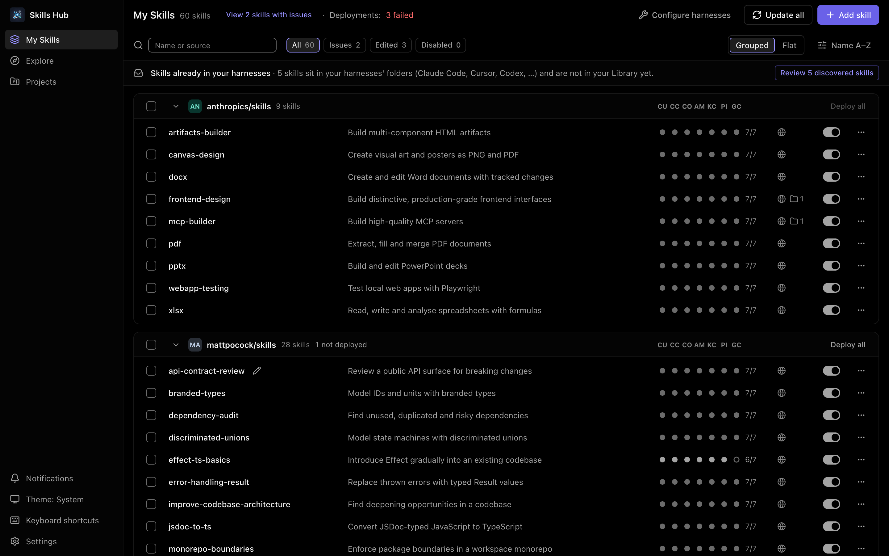
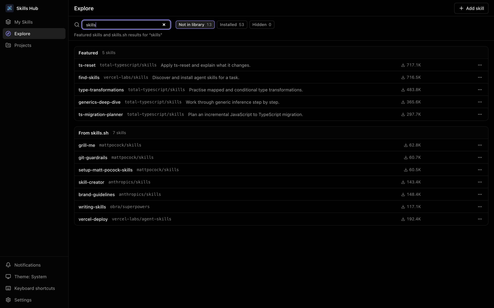
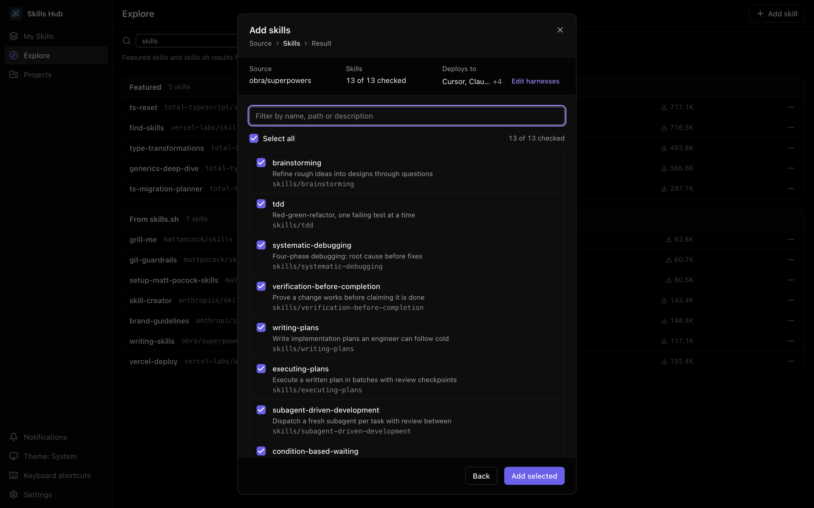
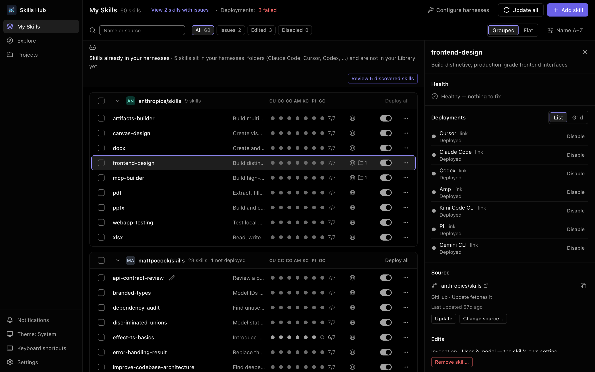

# Skills Hub (Tauri Desktop)

A cross-platform desktop app (Tauri + React) to manage Agent Skills in one place and deploy them to many AI coding harnesses — Claude Code, Cursor, Codex, … — in their global skills folders or in your projects (prefer symlink/junction, fallback to copy) — “Install once, deploy everywhere”.

## Documentation

- English (default): `README.md` (this file)

## Key Features

- **Explore page**: Browse featured skills (ClawHub, updated daily) and search online (skills.sh); preview a skill's files, then add it to your Library and deploy it to your selected harnesses
- **Inspector**: Select a skill to see its health, source and per-harness deployments, repair what failed, and browse its files with Markdown rendering and syntax highlighting (40+ languages)
- **Command palette**: ⌘K / Ctrl+K finds a skill, a place or an action
- **Unified view**: Your Library of skills and where each one is deployed, per harness
- **Onboarding import**: Scan existing skills in installed harnesses, import them into your Library, and deploy — an original is removed only when it is byte-identical to the imported copy; a same-named but different sibling is kept and reported, unless you choose "Remove the other copies" in the review
- **Import sources**: Local folder / Git URL (including multi-skill repo selection, `.claude/skills/` directory support); GitHub sources download through the GitHub API where possible (recording the real commit) and fall back to cloning
- **Update / Update all**: Re-fetch from source and bring every deployed copy back into line; updating many skills fetches them in parallel and reports the outcome of each skill and each harness it touched
- **New harness detection**: Detect newly installed harnesses and offer to deploy your skills to them

### My Skills


### Explore & Search


### Manual Add


### Skill Detail


## Supported AI Coding Harnesses

| key | Display name | skills dir (relative to `~`) | project skills dir | detect dir (relative to `~`) |
| --- | --- | --- | --- | --- |
| `agents_skills` | .agents/skills | `.agents/skills` | `.agents/skills` | `.agents` |
| `cursor` | Cursor | `.cursor/skills` | `.agents/skills` | `.cursor` |
| `claude_code` | Claude Code | `.claude/skills` | `.claude/skills` | `.claude` |
| `codex` | Codex | `.codex/skills` | `.agents/skills` | `.codex` |
| `opencode` | OpenCode | `.config/opencode/skills` | `.agents/skills` | `.config/opencode` |
| `antigravity` | Antigravity | `.gemini/antigravity/global_skills` | `.agents/skills` | `.gemini/antigravity` |
| `amp` | Amp | `.config/agents/skills` | `.agents/skills` | `.config/amp` |
| `kimi_cli` | Kimi Code CLI | `.config/agents/skills` | `.agents/skills` | `.kimi-code` or `.kimi` |
| `augment` | Augment | `.augment/skills` | `.augment/skills` | `.augment` |
| `openclaw` | OpenClaw | `.openclaw/skills` | `skills` | `.openclaw` |
| `copaw` | QwenPaw | `.copaw/skill_pool` | `.copaw/skill_pool` | `.copaw` |
| `cline` | Cline | `.cline/skills` | `.agents/skills` | `.cline` |
| `codebuddy` | CodeBuddy | `.codebuddy/skills` | `.codebuddy/skills` | `.codebuddy` |
| `command_code` | Command Code | `.commandcode/skills` | `.commandcode/skills` | `.commandcode` |
| `continue` | Continue | `.continue/skills` | `.continue/skills` | `.continue` |
| `crush` | Crush | `.config/crush/skills` | `.crush/skills` | `.config/crush` |
| `junie` | Junie | `.junie/skills` | `.junie/skills` | `.junie` |
| `iflow_cli` | iFlow CLI | `.iflow/skills` | `.iflow/skills` | `.iflow` |
| `kiro_cli` | Kiro CLI | `.kiro/skills` | `.kiro/skills` | `.kiro` |
| `kode` | Kode | `.kode/skills` | `.kode/skills` | `.kode` |
| `mcpjam` | MCPJam | `.mcpjam/skills` | `.mcpjam/skills` | `.mcpjam` |
| `mistral_vibe` | Mistral Vibe | `.vibe/skills` | `.vibe/skills` | `.vibe` |
| `mux` | Xum | `.mux/skills` | `.mux/skills` | `.mux` |
| `openclaude` | OpenClaude IDE | `.openclaude/skills` | `.openclaude/skills` | `.openclaude` |
| `openhands` | OpenHands | `.openhands/skills` | `.openhands/skills` | `.openhands` |
| `pi` | Pi | `.pi/agent/skills` | `.pi/skills` | `.pi` |
| `qoder` | Qoder | `.qoder/skills` | `.qoder/skills` | `.qoder` |
| `qoderwork` | QoderWork | `.qoderwork/skills` | `.qoderwork/skills` | `.qoderwork` |
| `qwen_code` | Qwen Code | `.qwen/skills` | `.qwen/skills` | `.qwen` |
| `trae` | Trae | `.trae/skills` | `.trae/skills` | `.trae` |
| `trae_cn` | Trae CN | `.trae-cn/skills` | `.trae/skills` | `.trae-cn` |
| `zencoder` | Zencoder / Zenflow | `.zencoder/skills` | `.zencoder/skills` | `.zencoder` |
| `neovate` | Neovate | `.neovate/skills` | `.neovate/skills` | `.neovate` |
| `pochi` | Pochi | `.pochi/skills` | `.pochi/skills` | `.pochi` |
| `adal` | AdaL | `.adal/skills` | `.adal/skills` | `.adal` |
| `kilo_code` | Kilo Code | `.kilocode/skills` | `.kilocode/skills` | `.kilocode` |
| `roo_code` | Roo Code | `.roo/skills` | `.roo/skills` | `.roo` |
| `goose` | Goose | `.config/goose/skills` | `.goose/skills` | `.config/goose` |
| `gemini_cli` | Gemini CLI | `.gemini/skills` | `.agents/skills` | `.gemini` |
| `github_copilot` | GitHub Copilot | `.copilot/skills` | `.agents/skills` | `.copilot` |
| `clawdbot` | Clawdbot | `.clawdbot/skills` | `.clawdbot/skills` | `.clawdbot` |
| `droid` | Droid | `.factory/skills` | `.factory/skills` | `.factory` |
| `windsurf` | Devin (Windsurf) | `.codeium/windsurf/skills` | `.windsurf/skills` | `.codeium/windsurf` |
| `moltbot` | MoltBot | `.moltbot/skills` | `.moltbot/skills` | `.moltbot` |
| `hermes-agent` | Hermes Agent | `.hermes/skills` | `.hermes/skills` | `.hermes` |
| `letta_code` | Letta Code | `.letta/skills` | `.agents/skills` | `.letta` |
| `muse_code` | Muse Code | `.config/muse/skills` | `.agents/skills` | `.config/muse` |
| `poolside` | Poolside | `.config/poolside/skills` | `.agents/skills` | `.config/poolside` |
| `dirac` | Dirac | `.dirac/skills` | `.agents/skills` | `.dirac` |

`agents_skills` is scope-dependent. **Globally** it is a plain, independently selectable target: it
manages `~/.agents/skills` and nothing else — Cursor still reads `~/.cursor/skills`, Codex still reads
`~/.codex/skills`, so those harnesses keep their own rows in the global list. **In a project** it is an
aggregate shown as `.agents/skills (N harnesses)`: one folder, `<project>/.agents/skills`, that every harness
in the group reads (today nine: Cursor, Codex, OpenCode, Antigravity, Amp, Kimi Code CLI, Cline, Gemini CLI,
GitHub Copilot), so those harnesses have no separate project row. N is counted from the registry.

A **reader-only harness** has no skills folder of its own: it reads `~/.agents/skills` (and
`<project>/.agents/skills`), so Skills Hub lists it under the `.agents/skills` entry with its detected state
and never as a deployment target. Its row shows `—` for both skills dirs. A harness with no project skills dir
shows `—` in that column and is absent from a project's harness choices.

Environment-variable homes (`KIMI_CODE_HOME` and the like) are not honoured: Skills Hub always uses the
default folders above (an app launched from the Finder does not see your shell environment).

## Development

### Prerequisites

- Node.js 22+ (the frontend tests need it; CI uses 22)
- Rust (stable)
- Tauri system dependencies (follow Tauri official docs for your OS)

```bash
npm install
npm run tauri:dev
```

### Build

```bash
npm run lint
npm run build
npm run tauri:build
```

#### Platform build commands (from `package.json`)

- macOS (dmg): `npm run tauri:build:mac:dmg`
- macOS (universal dmg): `npm run tauri:build:mac:universal:dmg`
- Windows (MSI): `npm run tauri:build:win:msi`
- Windows (NSIS exe): `npm run tauri:build:win:exe`
- Windows (MSI+NSIS): `npm run tauri:build:win:all`
- Linux (deb): `npm run tauri:build:linux:deb`
- Linux (AppImage): `npm run tauri:build:linux:appimage`
- Linux (deb+AppImage): `npm run tauri:build:linux:all`

### Tests (Rust)

```bash
cd src-tauri
cargo test
```

## Contributing & Security

- Contributing: [`CONTRIBUTING.md`](CONTRIBUTING.md)
- Design system (tokens, primitives, motion, contrast): [`DESIGN.md`](DESIGN.md) — read it before changing UI; the styling rules are [ADR-0006](docs/adr/0006-styling-architecture.md)
- Code of Conduct: [`CODE_OF_CONDUCT.md`](CODE_OF_CONDUCT.md)
- Security: [`SECURITY.md`](SECURITY.md)

## FAQ / Notes

- Where are skills stored? In the Library folder, `~/.skillshub` by default (configurable in Settings).
- Does Cursor get symlinks too? Yes, since Skills Hub 1.2.1 — Cursor 2.5+ (IDE) and the current Cursor CLI discover symlinked skill directories. Skills deployed to Cursor by an earlier Skills Hub version stay as copies until you deploy them again with overwrite. If you run an older Cursor, keep it updated or re-deploy after upgrading.
- Why does deploying sometimes fall back to copy? Skills Hub prefers symlink/junction, but on some systems (especially Windows) symlinks may be restricted; in that case it falls back to directory copy.
- Why does a skill still show up in a harness after I disable or remove it? If Skills Hub could not remove the folder (permissions, a locked file), it keeps the deployment and marks it Failed instead of forgetting it, so the path stays visible and the same action can be retried. The same holds for removing a skill from a project and for removing a project or one of its harnesses.
- Why does the project matrix sometimes say statuses may be out of date? Deploy operations run one at a time. If one is running while the matrix loads, the stored statuses are shown without re-checking them against disk; they are re-checked once the operation finishes.
- What happens when a folder with the skill's name is already in a harness? Skills Hub asks before replacing it (identical content is replaced silently); choosing Keep leaves that folder alone and records the skill as off for that harness.
- macOS Gatekeeper note (unsigned/notarized builds, may vary by macOS version): if you see “damaged” or “unverified developer”, run `xattr -cr "/Applications/Skills Hub.app"` (https://v2.tauri.app/distribute/#macos).

## Supported Platforms

- macOS (verified)
- Windows (CI runs the Rust test suite on Windows; release builds smoke-tested on Windows 11)
- Linux (CI runs the Rust test suite on Linux; not smoke-tested on a desktop)

## License

MIT License — see `LICENSE`.
